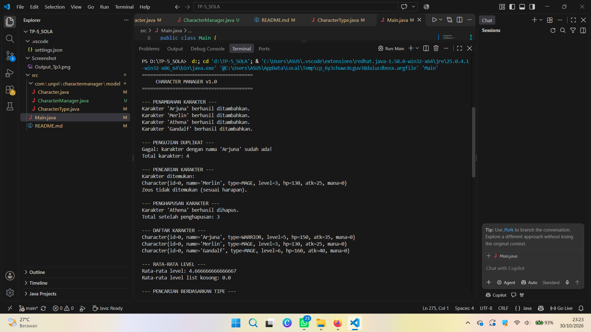
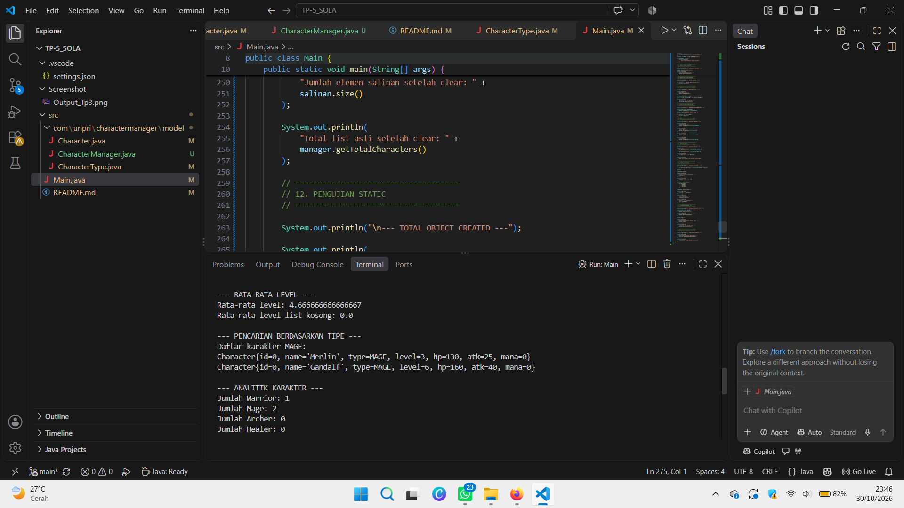
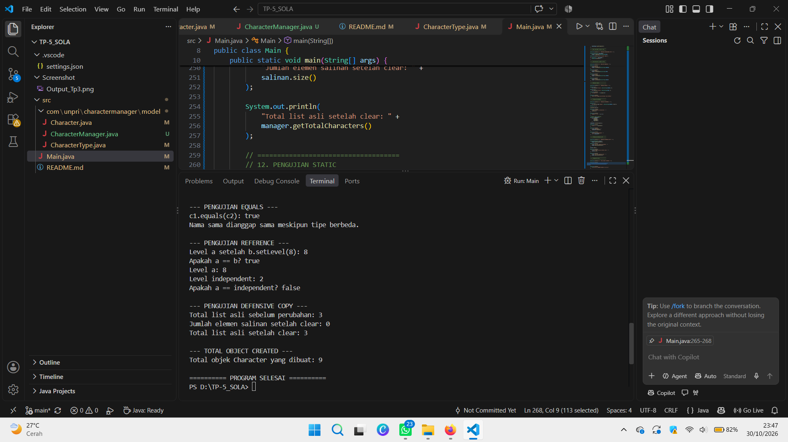

# TP5 — Method & Manipulasi Object (Praktik)

## 1. Informasi Tugas

- **Nama:** Sola Gratia Hutasoit
- **NIM:** [253303621286]
- **Kelas:** Pagi B
- **Program Studi:** Sistem Informasi
- **Mata Kuliah:** Java Visual
- **Tugas:** TP5 — Method & Manipulasi Object (Praktik)

## 2. Deskripsi Proyek

Character Manager adalah program berbasis Java yang digunakan untuk mengelola kumpulan objek karakter. Program ini menerapkan konsep Object-Oriented Programming (OOP), penggunaan `ArrayList`, manipulasi objek, serta pengujian reference.

Program memungkinkan pengguna menambahkan karakter, mencari karakter berdasarkan nama, menghapus karakter, menghitung rata-rata level, mencari karakter berdasarkan tipe, dan menghitung jumlah karakter berdasarkan tipe tertentu.

Selain itu, proyek ini menguji konsep `equals()`, operator `==`, defensive copy, serta penggunaan variabel `static` untuk menghitung jumlah objek yang dibuat.

## 3. Teknologi yang Digunakan

- Java
- Visual Studio Code
- Java Collections Framework
- `ArrayList`
- JavaDoc untuk dokumentasi method

## 4. Struktur Folder Proyek
TP-5_SOLA/
├── .vscode/
│   └── settings.json
├── Screenshot/
│   ├── TP5_CRUD.png
│   ├── TP5_Fitur_Baru.png
│   └── TP5_Eksperimen_Reference.png
├── src/
│   └── com/
│       └── unpri/
│           └── charactermanager/
│               ├── Main.java
│               ├── model/
│               │   ├── Character.java
│               │   ├── CharacterManager.java
│               │   └── CharacterType.java
│               └── view/
│                   └── MainWindow.java
└── README.md

## 5. Section TP5 — Fitur Program

### A. Operasi CRUD

Program menyediakan operasi dasar untuk mengelola data karakter.

- **Create:** menambahkan karakter baru menggunakan `addCharacter()`.
- **Read:** mencari karakter menggunakan `findByName()` dan menampilkan daftar menggunakan `getAllCharacters()`.
- **Update:** perubahan data karakter perlu diuji secara terpisah apabila operasi update tersedia.
- **Delete:** menghapus karakter menggunakan `removeCharacter()`.

Program juga menolak penambahan karakter dengan nama yang sudah terdaftar serta menangani input karakter `null`.

### B. Fitur Tambahan — Mini Challenge

#### 1. Menghitung Total Karakter

Method `getTotalCharacters()` mengembalikan jumlah karakter yang tersimpan dalam daftar.

#### 2. Menghitung Rata-rata Level

Method `getAverageLevel()` menghitung rata-rata level seluruh karakter. Jika daftar kosong, method mengembalikan `0.0` agar tidak terjadi pembagian dengan nol.

#### 3. Mencari Karakter Berdasarkan Tipe

Method `findByType(CharacterType type)` mencari semua karakter dengan tipe tertentu dan mengembalikan daftar hasil yang baru.

Tipe karakter yang tersedia meliputi:

- `WARRIOR`
- `MAGE`
- `ARCHER`
- `HEALER`

Method menolak parameter `null` menggunakan `IllegalArgumentException`.

### C. Fitur Analitik Baru — `countByType()`

Method baru yang diimplementasikan dalam `CharacterManager` adalah:
public int countByType(CharacterType type)

Method ini menghitung jumlah karakter berdasarkan tipe tertentu dan mengembalikan hasil berupa bilangan bulat (`int`).

**Cara kerja:**

1. Memvalidasi parameter agar tidak bernilai `null`.
2. Menginisialisasi variabel `count` dengan nilai `0`.
3. Melakukan perulangan terhadap seluruh karakter di dalam `characterList`.
4. Membandingkan tipe setiap karakter dengan parameter `type` menggunakan operator `==`.
5. Menambah nilai `count` jika tipe karakter sesuai.
6. Mengembalikan jumlah karakter yang ditemukan.

**Contoh penggunaan:**
int jumlahMage = manager.countByType(CharacterType.MAGE);
System.out.println("Jumlah Mage: " + jumlahMage);

Jika terdapat dua karakter bertipe `MAGE`, method akan mengembalikan nilai `2`.

**Javadoc method:**

/**
 * Menghitung jumlah karakter berdasarkan tipe tertentu.
 *
 * Method ini tidak mengembalikan ArrayList asli,
 * sehingga struktur data internal tetap terlindungi.
 *
 * @param type tipe karakter yang ingin dihitung
 * @return jumlah karakter dengan tipe tersebut
 */

**Rasional desain:**

- **Encapsulation:** penghitungan dilakukan di dalam `CharacterManager` tanpa mengekspos `ArrayList` internal.
- **Reusability:** method dapat menghitung berbagai tipe karakter tanpa perlu membuat method terpisah untuk setiap tipe.
- **Validasi:** parameter `null` ditolak dengan `IllegalArgumentException`.
- **Efisiensi:** penghitungan dilakukan melalui satu kali perulangan terhadap daftar karakter.
- **Maintainability:** logika penghitungan terpusat sehingga lebih mudah dipelihara dan dikembangkan.

Method ini memenuhi tujuan Bagian C karena merupakan method analitik yang diimplementasikan sendiri, dilengkapi Javadoc, dan menjaga enkapsulasi struktur data internal.

## 6. Eksperimen Reference dan Manipulasi Objek

### A. Pengujian `equals()`

Method `equals()` digunakan untuk membandingkan kesetaraan dua objek berdasarkan aturan yang ditentukan programmer.

Pada class `Character`, kesetaraan didasarkan pada nama karakter. Oleh karena itu, dua objek dengan nama sama dapat dianggap setara meskipun memiliki tipe atau level berbeda.

Hal ini berbeda dari implementasi bawaan `equals()` pada class `Object`, yang pada dasarnya membandingkan identitas objek.

### B. Pengujian Operator `==`

Operator `==` pada variabel objek memeriksa apakah dua variabel merujuk pada objek yang sama.

Contohnya:
Character a = new Character("Arjuna", CharacterType.WARRIOR, 5);
Character b = a;

System.out.println(a == b);

Hasilnya adalah `true` karena `a` dan `b` merujuk pada objek yang sama.

Jika `b` dibuat menggunakan `new Character(...)`, maka `a == b` akan bernilai `false` karena keduanya merupakan objek yang berbeda.

### C. Perubahan Objek melalui Reference

Ketika `b = a`, kedua variabel merujuk pada objek yang sama. Jika level objek diubah melalui `b`, perubahan tersebut juga terlihat ketika objek diakses melalui `a`.

Untuk membuat objek yang benar-benar independen, buat objek baru dan salin nilai-nilai yang diperlukan, bukan hanya menyalin reference.

### D. Defensive Copy

Method `getAllCharacters()` mengembalikan daftar baru menggunakan:
return new ArrayList<>(characterList);

Pendekatan ini melindungi struktur daftar internal. Jika pemanggil menghapus elemen dari daftar salinan, daftar asli di dalam `CharacterManager` tidak ikut terhapus.

Namun, salinan tersebut merupakan **shallow copy**. Objek `Character` di dalam daftar masih merujuk pada objek yang sama. Karena itu, perubahan properti objek melalui salah satu daftar masih dapat terlihat melalui daftar lainnya.

### E. Variabel `static` dan Total Objek

Variabel `static` digunakan untuk menyimpan data yang dimiliki bersama oleh seluruh objek dari class yang sama.

Dalam eksperimen ini, penghitung `totalCharacterCreated` digunakan untuk menghitung jumlah objek `Character` yang dibuat. Variabel tersebut tidak dimiliki secara terpisah oleh setiap objek, melainkan dibagikan pada tingkat class.

Jika tidak menggunakan `static`, penghitung akan menjadi milik masing-masing objek sehingga tidak dapat secara langsung menunjukkan jumlah total objek yang dibuat oleh seluruh program.
## 7. Dokumentasi Screenshot Output

Screenshot berikut digunakan sebagai bukti pengujian program.

### Screenshot 1 — TP5 CRUD

Menunjukkan:
- Penambahan karakter.
- Validasi nama duplikat.
- Pencarian karakter.
- Penghapusan karakter.
- Daftar karakter setelah penghapusan.

### Screenshot 2 — TP5 Fitur Baru

Menunjukkan:
- Penghitungan rata-rata level.
- Pencarian karakter berdasarkan tipe.
- Penghitungan jumlah karakter berdasarkan tipe.
- Pengujian penambahan karakter duplikat.

### Screenshot 3 — TP5 Eksperimen Reference

Menunjukkan:
- Pengujian `equals()`.
- Pengujian operator `==`.
- Perubahan level melalui reference.
- Pengujian defensive copy.
- Penghitungan total objek yang dibuat.

## 8. Google Docs — Bagian D

Dokumen Bagian D berisi analisis minimal 500 kata menggunakan penjelasan sendiri berdasarkan kode program.

Topik yang dibahas meliputi:

1. Perilaku reference pada `Character a` dan `Character b`, termasuk perubahan level dan hasil perbandingan `a == b`.
2. Perbedaan reference dengan primitive value serta analogi untuk menjelaskan keduanya.
3. Alasan penggunaan `static` pada penghitung total objek dan akibat jika tidak menggunakan `static`.
4. Alasan `equals()` bawaan class `Object` tidak cukup untuk memeriksa duplikat nama serta solusi melalui override `equals()`.
5. Risiko jika `getAllCharacters()` mengembalikan `ArrayList` asli dan kaitannya dengan konsep reference serta defensive copy.

**Link Google Docs Bagian D:**

[https://docs.google.com/document/d/1xs0x4kYOwM1PLqvYKu5NX8363OZEmkpKEZ5AvmxM_fQ/edit?tab=t.0]

Pastikan pengaturan akses dokumen adalah **Anyone with the link — Viewer** agar dosen dapat membuka dan membaca dokumen.

## 9. Cara Menjalankan Program

1. Buka folder proyek di Visual Studio Code.
2. Pastikan JDK telah terpasang.
3. Buka `Main.java`.
4. Jalankan program menggunakan tombol **Run** atau konfigurasi Java yang tersedia di VS Code.
5. Periksa hasil eksekusi pada terminal.

## 10. Kesimpulan

Proyek Character Manager menerapkan konsep OOP dan Java Collections untuk mengelola kumpulan objek karakter. Melalui implementasi CRUD, fitur analitik `countByType()`, serta eksperimen reference, program membantu memahami enkapsulasi, validasi parameter, manipulasi objek, kesetaraan objek, variabel `static`, dan defensive copy.

Pembuatan method baru juga menunjukkan pentingnya merancang fungsi yang dapat digunakan kembali, memiliki dokumentasi yang jelas, dan menjaga struktur data internal agar tidak diakses secara langsung oleh pemanggil.

---

**Mata Kuliah:** Java Visual 
**Tugas:** TP5 — Method & Manipulasi Object (Praktik)
